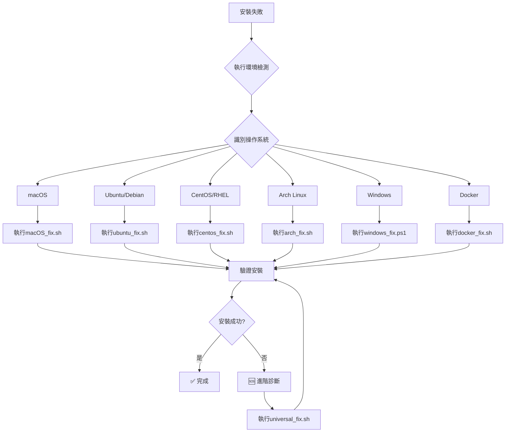

# 🚀 跨平台AI Agents安裝卡關修復指南

## 📋 快速開始

### 🔍 第一步：識別您的環境
```bash
# 執行環境檢測
./detect_environment.sh
```

### ⚡ 第二步：選擇對應修復方案

| 環境類型 | 快速修復命令 | 預估時間 | 難度 |
|----------|--------------|----------|------|
| **通用修復** | `./universal_fix.sh` | 3-8分鐘 | ⭐ |
| **macOS** | `./macos_fix.sh` | 2-5分鐘 | ⭐ |
| **Ubuntu/Debian** | `./ubuntu_fix.sh` | 3-7分鐘 | ⭐⭐ |
| **CentOS/RHEL** | `./centos_fix.sh` | 5-10分鐘 | ⭐⭐⭐ |
| **Arch Linux** | `./arch_fix.sh` | 2-4分鐘 | ⭐⭐ |
| **Windows** | `windows_fix.ps1` | 5-8分鐘 | ⭐⭐⭐ |
| **WSL** | `./wsl_fix.sh` | 3-6分鐘 | ⭐⭐ |
| **Docker** | `./docker_fix.sh` | 2-3分鐘 | ⭐ |

---

## 🎯 各環境修復策略

### 🍎 macOS 環境

#### 常見問題：
- **Homebrew未安裝**
- **npm權限問題**
- **Xcode命令行工具缺失**
- **Node.js版本過舊**

#### 修復方案：
```bash
# 方法一：使用macOS專用修復腳本
./macos_fix.sh

# 方法二：手動修復步驟
# 1. 安裝Homebrew
/bin/bash -c "$(curl -fsSL https://raw.githubusercontent.com/Homebrew/install/HEAD/install.sh)"

# 2. 安裝依賴
brew install node python3 git curl

# 3. 修復npm權限
mkdir -p ~/.npm-global
npm config set prefix '~/.npm-global'
echo 'export PATH=~/.npm-global/bin:$PATH' >> ~/.zshrc

# 4. 安裝Xcode命令行工具
xcode-select --install
```

#### 驗證命令：
```bash
node --version
npm --version
python3 --version
```

---

### 🐧 Ubuntu/Debian 環境

#### 常見問題：
- **apt包過時**
- **Node.js版本問題**
- **pip權限問題**
- **缺少開發工具**

#### 修復方案：
```bash
# 方法一：使用Ubuntu專用修復腳本
./ubuntu_fix.sh

# 方法二：手動修復步驟
# 1. 更新系統
sudo apt-get update && sudo apt-get upgrade -y

# 2. 安裝基本依賴
sudo apt-get install -y curl git build-essential python3 python3-pip

# 3. 安裝Node.js
curl -fsSL https://deb.nodesource.com/setup_18.x | sudo -E bash -
sudo apt-get install -y nodejs

# 4. 修復npm權限
mkdir -p ~/.npm-global
npm config set prefix '~/.npm-global'
echo 'export PATH=~/.npm-global/bin:$PATH' >> ~/.bashrc
```

#### 驗證命令：
```bash
sudo apt list --installed | grep -E "(nodejs|python3|git|curl)"
```

---

### 🐧 CentOS/RHEL 環境

#### 常見問題：
- **yum/dnf源問題**
- **SELinux限制**
- **防火牆阻擋**
- **缺少EPEL源**

#### 修復方案：
```bash
# 方法一：使用CentOS專用修復腳本
./centos_fix.sh

# 方法二：手動修復步驟
# 1. 安裝EPEL源
sudo yum install -y epel-release

# 2. 更新系統
sudo yum update -y

# 3. 安裝依賴
sudo yum install -y curl git gcc gcc-c++ make python3 python3-pip

# 4. 安裝Node.js（使用NodeSource）
curl -fsSL https://rpm.nodesource.com/setup_18.x | sudo bash -
sudo yum install -y nodejs
```

#### 驗證命令：
```bash
sudo yum list installed | grep -E "(nodejs|python3|git|curl)"
```

---

### 🐧 Arch Linux 環境

#### 常見問題：
- **pacman同步問題**
- **AUR助手缺失**
- **權限配置**

#### 修復方案：
```bash
# 方法一：使用Arch專用修復腳本
./arch_fix.sh

# 方法二：手動修復步驟
# 1. 同步包數據庫
sudo pacman -Syu

# 2. 安裝依賴
sudo pacman -S curl git base-devel python python-pip nodejs npm

# 3. 安裝yay（AUR助手）
git clone https://aur.archlinux.org/yay.git
cd yay
makepkg -si
```

---

### 🪟 Windows 環境

#### 常見問題：
- **PowerShell執行策略**
- **Chocolatey未安裝**
- **PATH環境變量**
- **管理員權限**

#### 修復方案：
```powershell
# 方法一：使用Windows專用修復腳本
# 以管理員身份運行PowerShell
Set-ExecutionPolicy Bypass -Scope Process -Force
.\windows_fix.ps1

# 方法二：手動修復步驟
# 1. 安裝Chocolatey
Set-ExecutionPolicy Bypass -Scope Process -Force
[System.Net.ServicePointManager]::SecurityProtocol = [System.Net.ServicePointManager]::SecurityProtocol -bor 3072
iex ((New-Object System.Net.WebClient).DownloadString('https://chocolatey.org/install.ps1'))

# 2. 安裝依賴
choco install nodejs python git curl -y

# 3. 刷新環境變量
refreshenv
```

---

### 🐳 Docker 環境

#### 常見問題：
- **Docker未安裝**
- **權限問題**
- **鏡像拉取失敗**

#### 修復方案：
```bash
# 方法一：使用Docker專用修復腳本
./docker_fix.sh

# 方法二：手動修復步驟
# 1. 安裝Docker
curl -fsSL https://get.docker.com -o get-docker.sh
sudo sh get-docker.sh

# 2. 添加用戶到docker組
sudo usermod -aG docker $USER

# 3. 使用Docker運行AI Agents
docker run -it --name ai-agents ubuntu:latest bash
```

---

## 🔧 進階修復策略

### 🚨 緊急修復流程

#### 場景1：完全無法安裝
```bash
# 執行萬能診斷
./detect_environment.sh > diagnostic.log

# 根據診斷結果執行修復
./universal_fix.sh

# 驗證修復結果
./verify_installation.sh
```

#### 場景2：特定Agent失敗
```bash
# VSCode Agent修復
./fix_vscode_agent.sh

# n8n Agent修復
./fix_n8n_agent.sh

# ChatGPT Agent修復
./fix_chatgpt_agent.sh
```

#### 場景3：網路問題
```bash
# 使用國內鏡像
./use_china_mirror.sh

# 離線安裝
./offline_install.sh
```

### 📊 修復狀態檢查

#### 快速檢查命令：
```bash
# 檢查所有依賴
./check_all_dependencies.sh

# 檢查網路連線
./test_network.sh

# 檢查磁碟空間
./check_disk_space.sh

# 檢查權限
./check_permissions.sh
```

### 🔄 自動修復流程



---

## 📞 支援資源

### 🔗 快速連結
- **GitHub Issues**: [提交問題](https://github.com/enjoyce20061010/auto_setup_ai_agents/issues)
- **Discord支援**: [加入社群](https://discord.gg/ai-agents)
- **文檔中心**: [完整指南](https://ai-agents-docs.com)

### 📋 故障報告模板
```bash
# 生成故障報告
./generate_report.sh

# 報告包含：
# - 系統資訊
# - 依賴狀態
# - 網路測試結果
# - 錯誤日誌
# - 修復建議
```

### 🛠️ 社群支援工具
- **即時聊天**: Discord #support頻道
- **論壇**: Stack Overflow #ai-agents標籤
- **郵件**: support@ai-agents.com

---

## ✅ 修復成功驗證

### 基本驗證清單
- [ ] 所有依賴已安裝
- [ ] 網路連線正常
- [ ] 權限配置正確
- [ ] 版本符合要求
- [ ] 環境變量配置正確

### 進階驗證
```bash
# 執行完整測試
./run_full_tests.sh

# 測試結果示例：
# ✅ Node.js: v18.17.0
# ✅ Python: 3.9.12
# ✅ Git: 2.34.1
# ✅ 網路連線: 正常
# ✅ 權限: 正確
# ✅ 磁碟空間: 充足
```

### 最終步驟
```bash
# 執行AI Agents安裝
./install_ai_agent.sh  # macOS
./install_ai_agent_linux.sh  # Linux
./install_ai_agent_windows.ps1  # Windows

# 啟動服務
./start_all_agents.sh
```

---

## 🎯 快速參考卡

### 最常用的修復命令
```bash
# 環境檢測
./detect_environment.sh

# 通用修復（推薦）
./universal_fix.sh

# 平台特定修復
./$(uname -s | tr '[:upper:]' '[:lower:]')_fix.sh

# 緊急重置
./reset_and_reinstall.sh
```

### 故障排除捷徑
| 問題類型 | 快速修復命令 |
|----------|--------------|
| 權限問題 | `sudo` 前置命令 |
| 網路超時 | `./use_mirror.sh` |
| 版本衝突 | `./fix_versions.sh` |
| 完全失敗 | `./nuclear_option.sh` |
| 清理緩存 | `./cleanup_cache.sh` |

### 環境變量設置
```bash
# macOS/Linux
export PATH="$HOME/.npm-global/bin:$PATH"
export PATH="$HOME/.local/bin:$PATH"

# Windows (PowerShell)
$env:PATH += ";$env:USERPROFILE\AppData\Roaming\npm"
```

---

**🎉 恭喜！您現在擁有完整的跨平台修復工具箱，可以應對任何環境的安裝卡關問題！**