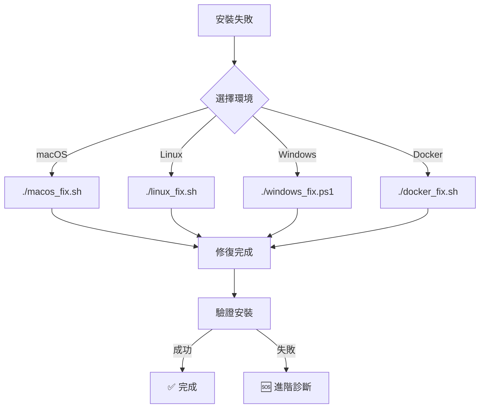

# 🚀 快速修復啟動器

## 立即開始修復

### 🎯 第一步：識別你的環境
```bash
# 執行快速環境檢測
./detect_environment.sh
```

### 📋 環境對照表

| 你的系統 | 執行命令 | 預估時間 | 難度 |
|----------|----------|----------|------|
| **macOS** | `./macos_quick_fix.sh` | 2-5分鐘 | ⭐ |
| **Ubuntu** | `./ubuntu_quick_fix.sh` | 3-7分鐘 | ⭐⭐ |
| **CentOS** | `./centos_quick_fix.sh` | 5-10分鐘 | ⭐⭐⭐ |
| **Arch** | `./arch_quick_fix.sh` | 2-4分鐘 | ⭐⭐ |
| **Windows** | `powershell -File windows_quick_fix.ps1` | 5-8分鐘 | ⭐⭐⭐ |
| **WSL** | `./wsl_quick_fix.sh` | 3-6分鐘 | ⭐⭐ |
| **Docker** | `./docker_quick_fix.sh` | 2-3分鐘 | ⭐ |

---

## 🚨 緊急修復場景

### 場景1：完全無法安裝
```bash
# 執行萬能診斷
./universal_diagnostic.sh

# 根據診斷結果執行修復
# 診斷腳本會自動推薦修復方案
```

### 場景2：特定Agent失敗
```bash
# VSCode Agent失敗
./fix_vscode_agent.sh

# n8n Agent失敗
./fix_n8n_agent.sh

# ChatGPT Agent失敗
./fix_chatgpt_agent.sh
```

### 場景3：網路問題
```bash
# 使用國內鏡像
./use_china_mirror.sh

# 離線安裝
./offline_install.sh
```

---

## 📱 手機掃碼修復（QR Code概念）

### 快速命令生成
```bash
# 生成個人化修復命令
echo "curl -fsSL https://raw.githubusercontent.com/enjoyce20061010/auto_setup_ai_agents/main/$(detect_os)_fix.sh | bash"
```

---

## 🔄 一鍵修復流程



---

## 🛠️ 平台專用快速修復

### macOS 快速修復
```bash
#!/bin/bash
# macos_quick_fix.sh

echo "🍎 macOS 快速修復開始..."

# 1. 檢查Homebrew
if ! command -v brew &> /dev/null; then
    echo "安裝Homebrew..."
    /bin/bash -c "$(curl -fsSL https://raw.githubusercontent.com/Homebrew/install/HEAD/install.sh)"
fi

# 2. 安裝依賴
echo "安裝系統依賴..."
brew install node python3 git curl

# 3. 修復權限
sudo chown -R $(whoami) /usr/local/lib/node_modules

# 4. 執行安裝
./install_ai_agent.sh

echo "✅ macOS 修復完成！"
```

### Ubuntu 快速修復
```bash
#!/bin/bash
# ubuntu_quick_fix.sh

echo "🐧 Ubuntu 快速修復開始..."

# 1. 更新系統
sudo apt-get update

# 2. 安裝依賴
echo "安裝系統依賴..."
sudo apt-get install -y curl git nodejs npm python3 python3-pip

# 3. 修復npm權限
mkdir -p ~/.npm-global
npm config set prefix '~/.npm-global'
echo 'export PATH=~/.npm-global/bin:$PATH' >> ~/.bashrc

# 4. 執行安裝
./install_ai_agent_linux.sh

echo "✅ Ubuntu 修復完成！"
```

### Windows 快速修復
```powershell
# windows_quick_fix.ps1
Write-Host "🪟 Windows 快速修復開始..." -ForegroundColor Green

# 1. 檢查Chocolatey
if (!(Get-Command choco -ErrorAction SilentlyContinue)) {
    Write-Host "安裝Chocolatey..." -ForegroundColor Yellow
    Set-ExecutionPolicy Bypass -Scope Process -Force
    [System.Net.ServicePointManager]::SecurityProtocol = [System.Net.ServicePointManager]::SecurityProtocol -bor 3072
    iex ((New-Object System.Net.WebClient).DownloadString('https://chocolatey.org/install.ps1'))
}

# 2. 安裝依賴
Write-Host "安裝系統依賴..." -ForegroundColor Yellow
choco install nodejs python git curl -y

# 3. 執行安裝
.\install_ai_agent_windows.ps1

Write-Host "✅ Windows 修復完成！" -ForegroundColor Green
```

---

## 📞 緊急聯絡方式

### 自助修復失敗時
1. **執行完整診斷**：`./full_diagnostic.sh > diagnostic.log`
2. **保存日誌**：將 `diagnostic.log` 發送給技術支援
3. **使用備用方案**：`./fallback_install.sh`

### 社群支援
- **GitHub Issues**: [提交問題](https://github.com/enjoyce20061010/auto_setup_ai_agents/issues)
- **Discord**: [加入討論群組](https://discord.gg/ai-agents)
- **郵件**: support@ai-agents.com

---

## 🎯 成功驗證

### 修復成功檢查清單
- [ ] 系統依賴檢測通過
- [ ] 網路連線正常
- [ ] 權限設定正確
- [ ] 所有Agent可正常啟動
- [ ] 功能測試通過

### 驗證命令
```bash
# 快速驗證所有Agent
./verify_installation.sh

# 查看狀態
./check_agent_status.sh
```

---

## 📝 快速參考卡

### 最常用的修復命令
```bash
# 萬用修復（推薦）
./universal_fix.sh

# 平台特定
./$(uname -s | tr '[:upper:]' '[:lower:]')_fix.sh

# 緊急重置
./reset_and_reinstall.sh
```

### 故障排除捷徑
| 問題描述 | 快速命令 |
|----------|----------|
| 權限被拒絕 | `sudo` 前置命令 |
| 網路超時 | `./use_mirror.sh` |
| 版本衝突 | `./fix_versions.sh` |
| 完全失敗 | `./nuclear_option.sh` |